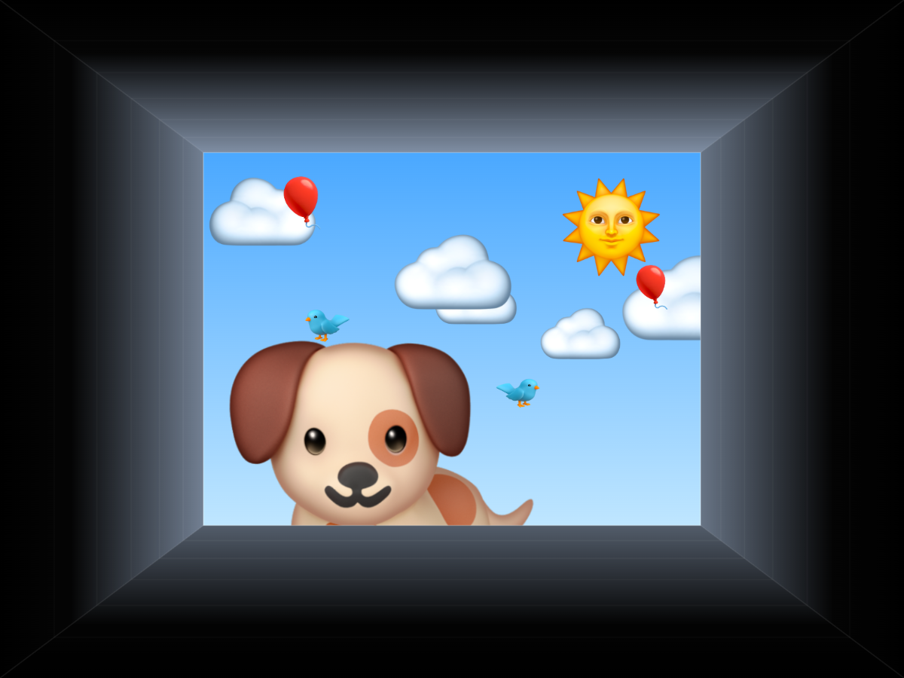
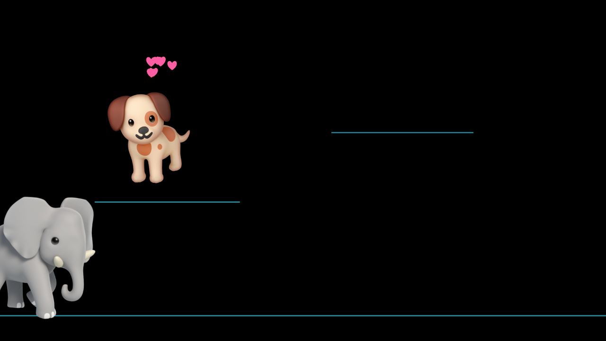
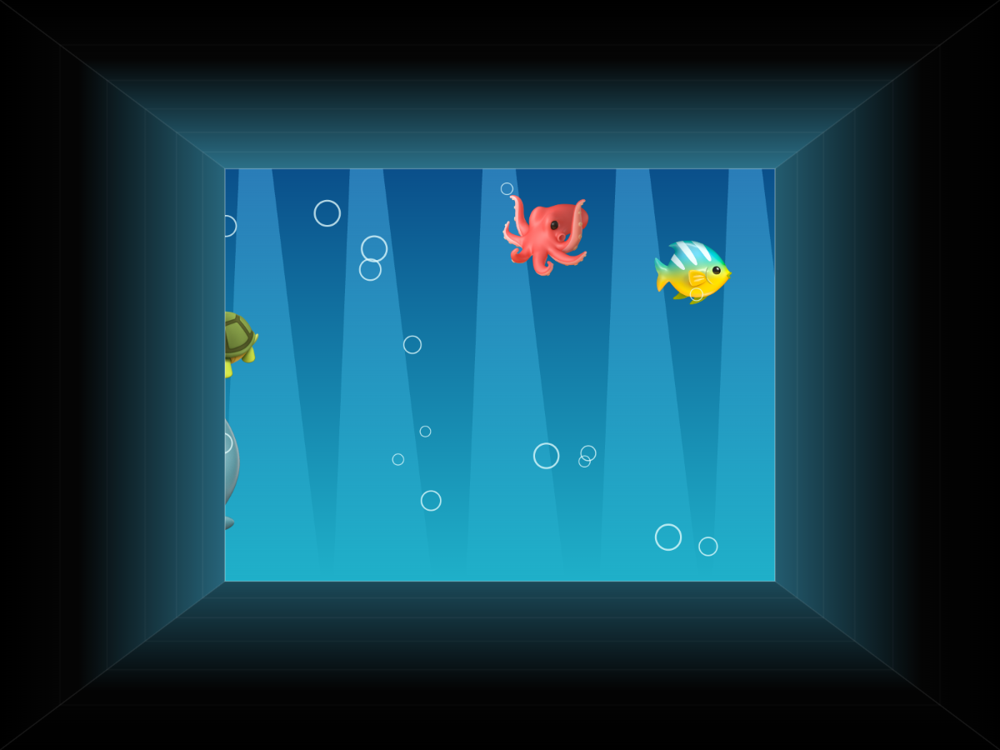
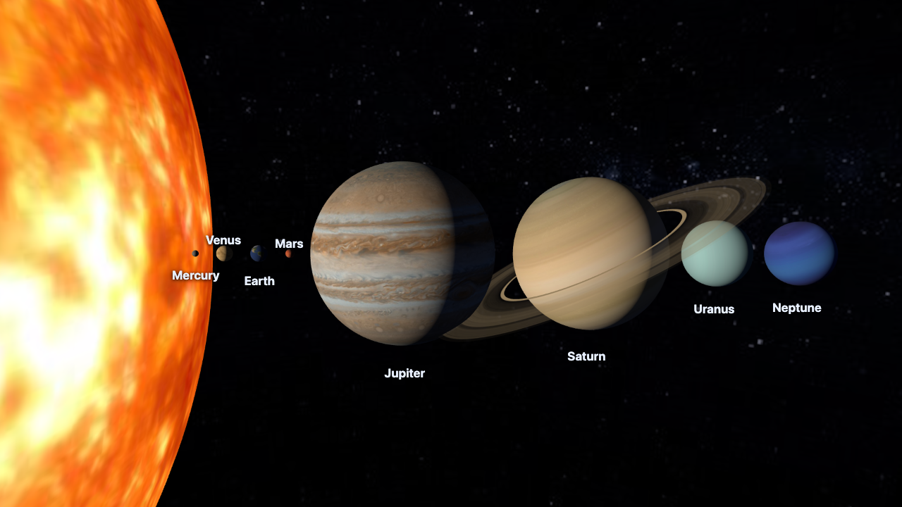
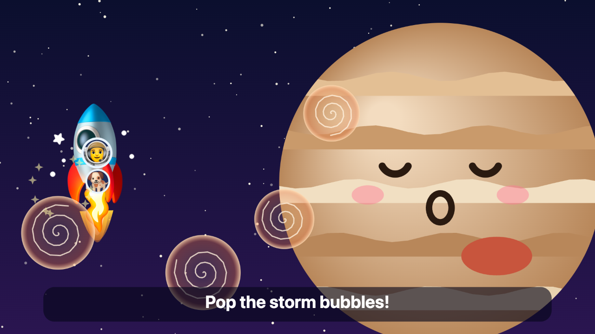
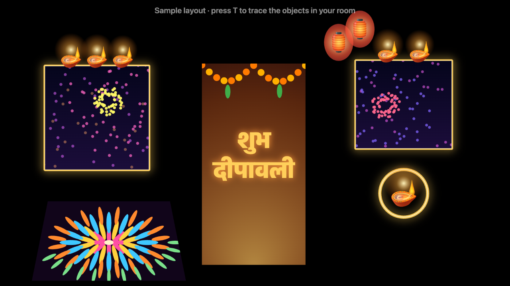
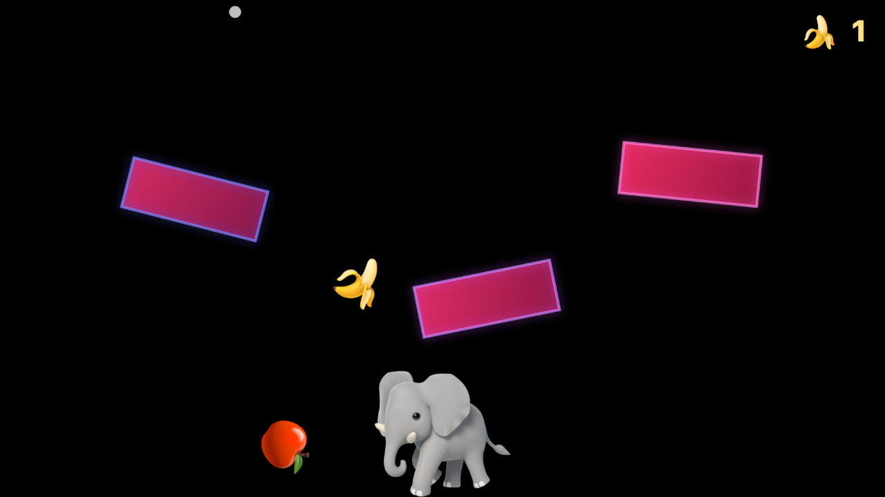
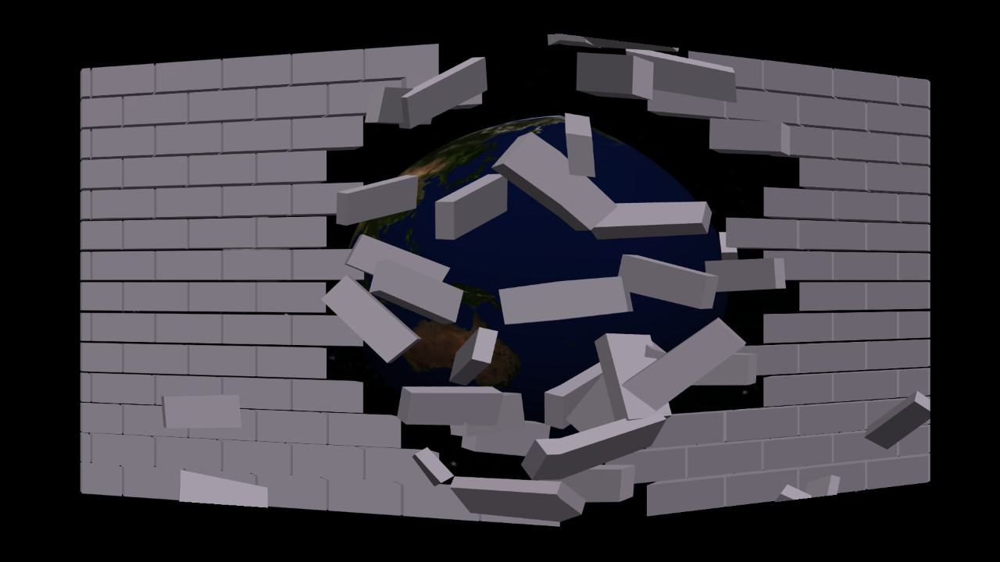

# MayaSabha (मायासभा)

*Created by [Dr. Atul Tiwari](https://atultiwari.com/)*

> *In the Mahabharata, the architect Maya built the Pandavas a hall of illusions, where polished floors
> looked like pools of water and pools looked like floors.*

**MayaSabha turns your living room into a hall of illusions.** A projector, a browser and a phone are all
it takes: characters live on your real walls and hop between your picture frames, and a window opens in
the ceiling to the sky, the sea or the stars. It's made for small children and their families, and runs
fully offline on your home Wi-Fi.



**▶ Play online:** [atultiwari.github.io/mayasabha](https://atultiwari.github.io/mayasabha/). Built-in characters, keyboard controls. For the phone remote and your own characters, [run it at home](#quick-start).

- **Plain web pages, no install for players.** Fullscreen black pages run on the computer connected to the
  projector. Black projects as no light, so only the magic shows on the wall.
- **Corner-pin warp** fits the picture to any wall, floor or ceiling, even with the projector tilted.
- **Draw ledges** over real objects (frame tops, shelves, door frames) and characters walk and hop on them.
- **Your phone is the remote:** scan the QR code on the home page; buttons appear for whatever is running.
- **Clap to play:** the microphone detects claps and shouts (no audio leaves the computer).
- **Your own characters:** swap in pictures of your child's favourites, kept private and out of git.
- Plain JavaScript ES modules, no build step, one small Node server, 60+ unit tests.

## Room Map: set up your wall once

Open **Room Map**, fit the picture to the wall (E) and trace the real objects (T): picture frames, a shelf,
the door, a clock. Every wall activity then uses the same map:

- **Maya Masks** lights the objects up.
- **Room Pet** walks along the tops of frames, shelves and the door.
- **Cushion Physics** (wall mode, W) makes them solid, so fruit lands on the frame and slides off.

Tag a framed **puja picture** (or any picture you'd rather not cover) as `picture`: activities only decorate
around it (gold glow, diyas on top, a marigold garland) and never project over it or bounce things off it.
This is enforced by a unit test across every scene.

## Activities

### Room Pet 🐶

A puppy lives on your wall. It walks along the ledges you drew over your frames, hops between them, eats
fruit you drop from the phone, jumps for joy when someone claps, follows visiting friends (an elephant, a
monkey on a vine, a mouse it chases, a waddling penguin) and falls asleep when left alone.



| Key | Phone | What happens |
|---|---|---|
| 1 2 3 | 🍌 🍎 🍊 | Fruit falls, often onto a frame; the puppy climbs up and eats it |
| 4 5 6 7 | 🐘 🐒 🐭 🐧 | A friend visits: elephant, monkey, mouse (chase!), penguin |
| Space | 🎉 | Jump for joy |
| C B S Z | 🐶 🔊 🪑 💤 | Come / woof / sit / sleep |
| M | – | Microphone on: clap and the puppy jumps |
| E | – | Edit: fit the corners, draw ledges over real objects (G sets the floor line) |
| D | 🎬 | Demo sequence for filming |
| [ ] | – | Puppy smaller / bigger |

Tip for little ones: start with the puppy asleep (Z) and let your child clap to wake it, then let them
choose the fruit on the phone.

### Ceiling Window 🪟

A hole opens in the ceiling. Lie down below it and look up into a **sky** (clouds, birds, balloons that
float away), an **aquarium** (fish, octopus, whale, bubbles) or a **starry night**, while friends **peek
down over the edge**. Bedtime mode fades the stars to black over ten minutes.



| Key | Phone | What happens |
|---|---|---|
| 1 2 3 4 | ☁️ 🐠 🌙 🙈 | Sky / aquarium / stars / peek-a-boo (someone peeks every few seconds) |
| P, Space | per character | Someone peeks in, with a spoken "Peek-a-boo!" |
| N | 😴 | Bedtime: starry night that fades to black over 10 minutes |
| ← → ↑ ↓ | – | Aim the depth at where the viewer lies (the illusion works from one spot) |
| [ ] | – | Hole shallower / deeper |
| O | – | Turn the picture around so faces look upright from where the viewer lies |
| E | – | Fit the 4 corners on the ceiling |

Switch ceiling fans off while projecting. The shaft walls fade to black at the rim, so the border of the
projection melts into the real ceiling.

### Bubbles & Butterflies 🫧🦋 (camera)

Giant soap bubbles float up the wall and **pop wherever a child touches them**; some hide a favourite
character or a fruit that pops out and says its name. **Butterflies land on a hand held still** and scatter
when someone swipes. Tracking uses the camera (MediaPipe pose with a body mask, all on-device); the mouse
works as a hand too.

| Key | Phone | What happens |
|---|---|---|
| 1 2 3 | 🫧 🦋 ✨ | Bubbles / butterflies / both |
| Space | 🎁 | A big bubble with a surprise inside (phone: choose who) |
| [ ] | ➕ ➖ | Fewer / more |
| C | 📷 | Camera on/off |
| K | – | Calibrate: click the 4 projected dots in the camera view |
| X | – | Mirror (camera faces the players instead of the wall) |
| I | – | Show what the camera sees (body mask, hands) |

Camera setup: put the camera next to the projector, facing the wall, then press **C** and **K**. Run
`npm run setup` once to keep tracking fully offline (otherwise it loads from a CDN). To try it without a
camera, open `apps/bubbles/?video=<path-to-a-video>`.

### Antariksh 🪐 (अंतरिक्ष, the solar system)

The real solar system on your ceiling or wall: a glowing Sun, the eight planets with real textures, tilts
and spins, Earth's Moon, Mars's Phobos and Deimos, Jupiter's four big moons, Saturn's rings and Titan, all
orbiting at their true relative speeds (sped up). Fly to any body and hear its name and one simple fact in
**English or Hindi**, see how the planets' **true sizes** compare to each other and to the Sun, or take a guided tour.



| Key | Phone | What happens |
|---|---|---|
| S 1–8 M | ☀️ 🌍 🪐 🌙 … | Fly to the Sun, a planet (in order from the Sun), or the Moon |
| Space / T | 🌌 | Whole system / straight up (best on a ceiling) |
| Z | 📏 | True sizes compared |
| A | 🚀 | Guided tour with narration |
| L | 🔤 | English / हिन्दी |
| [ ] P | 🐢 🐇 | Slower / faster / pause time |

Spoken words (character names, story narration) are off by default; tick "Spoken words" on the homepage to turn them on. Hindi narration uses your computer's Hindi voice (on macOS: System Settings → Accessibility → Spoken
Content → add a Hindi voice such as Lekha).

### Rocket Ride to Chanda Mama 🚀🌝 (bedtime story)

A 8–10 minute bilingual (English / हिन्दी) bedtime story where **your child is the hero** (press N to type
their name; it stays in that browser). A co-pilot (the pet character) flies along. Each stop needs one
small action, from a real clap (microphone), a wave (camera or mouse), a pop or a count, or from the phone:

1. **Launch:** clap three times to count down, then blast off.
2. **The Moon (Chanda Mama):** clap to jump high and leave footprints.
3. **Mars:** wave away the dust storm to find a little robot.
4. **Jupiter:** pop the storm bubbles.
5. **Saturn:** slide around the rings and count the moons.
6. **The Sun:** sunglasses on! Wave goodbye.
7. **Home:** every planet says goodnight and falls asleep, then the screen fades to dark.

Nobody can fail: every action also finishes by itself after a while, and the phone has a **Help**
button. ← → skip chapters, R restarts, L switches language.



### Maya Masks 🪔 (projection mapping)

**Real projection mapping, in the browser.** Trace the objects in your room once (picture frames, the
door, a clock, balloons, a patch of floor) as rectangles, ellipses or polygons, and tag each one. Every
scene then paints each object to its exact outline, so the objects themselves seem to change:

- **Diwali:** gold-lit frames with diyas on top and fireworks inside, a marigold toran and a glowing
  "शुभ दीपावली" on the door, lantern balloons, a diya in the clock, a rangoli that draws itself on the floor.
- **Magic:** aquarium frames, a swirling portal door (your pet character steps out), googly-eyed balloons
  that follow you, a rainbow clock, a starry floor.
- **Party:** every object pulses to the music (microphone) with confetti.
- **Align:** plain white shapes, for lining the outlines up with the real objects.



| Key | Phone | What happens |
|---|---|---|
| T | – | Trace mode: 1 rectangle, 2 ellipse, 3 polygon; Tab sets the tag; drag to adjust |
| 1 2 3 4 | 🪔 ✨ 🎉 📐 | Diwali / Magic / Party / Align |
| Space | 🎆 | Fireworks in every frame |
| M | 🎤 | Microphone for Party mode |
| B | ⚫ | Blackout |

No dedicated mapping software is needed for one projector on flat-ish objects: the browser does the
warp, the masks and the content. (Multi-projector blending or curved 3D surfaces are where tools like
MadMapper, HeavyM or the free MapMap come in.)

### Cushion Physics 🛋️ (camera + real objects)

Put a few **red cushions** (or sticky notes, or any brightly coloured objects) on the floor or against
the wall. The camera finds them by colour and they become **solid** in a physics world: fruit tumbles
down, bounces off the real cushions, and has to reach Hathi waiting at the bottom. Slide a cushion to
change the path. In **Marbles** mode every bounce plays a note, so the cushions become a musical toy.
Without a camera, drag the virtual pillows with the mouse (that is also how the online version plays).



| Key | Phone | What happens |
|---|---|---|
| 1 2 | 🍌 🎵 | Feed Hathi / Marbles |
| Space | ⬇️ | Drop one more |
| ← → | ⬅️ ➡️ | Move Hathi |
| C K X | 📷 | Camera on, calibrate to the projection, mirror |
| O | 🎨 | Object colour: red / pink / orange / yellow / green / blue |

The colour detector is a few lines of plain JavaScript (no OpenCV): colour mask → connected blobs →
convex outlines, tested on photos of real cushions.

### Kona 🧊 (कोना, corner illusion)

**Anamorphic projection mapping on an inside corner.** Point the projector at a corner where two walls
meet. Mark six points (the top and bottom of the corner line, and the outer edges of each wall), type in
the rough size of the projected area, and say where the viewer stands. Each wall is then rendered with an
off-axis camera from the viewer's eye (Kooima's generalised perspective projection) and pinned onto its
wall with a per-pixel homography, so from that spot the two walls stop looking like walls:

- **Break the Wall:** the corner turns to bricks that tumble out into the room, revealing Earth in space.
- **Floating Cube:** a glowing cube hovers out of the corner, neon lines run back into the walls.
- **Aquarium Corner:** both walls become glass with fish swimming deep behind them.
- **Saturn Rising:** Saturn drifts out from behind the corner into the room.

The illusion is exact from the viewer spot, which is perfect for filming: put the phone there.



| Key | What happens |
|---|---|
| K | Mark the corner (drag 6 dots); a 10 cm grid shows on both walls |
| M / P | Measurements (m) / viewer spot (distance, eye height, angle) |
| 1–4 / Space | Scenes / play again |

## Quick start

```bash
git clone https://github.com/atultiwari/mayasabha.git
cd mayasabha
npm install
npm run setup   # once: offline body tracking for camera activities
npm start
```

- **Stage:** open `http://localhost:5190/` **on the computer connected to the projector**. Use `localhost`
  there, because browsers only allow the microphone on `localhost` or https.
- **Phone remote:** the home page shows a QR code and the address (e.g. `http://192.168.x.x:5190/remote/`).
  Scan it with your phone on the same Wi-Fi.

Needs Node 20+ and a modern browser (Chrome, Edge, Safari or Firefox).

### Fitting it to your room (once per spot)

1. Open an activity and press **F** for fullscreen.
2. Press **E**. Drag the 4 numbered corners until the picture sits where you want it.
3. Room Pet only: drag a line along the **top of each real object** characters can stand on (picture frames,
   door frame, shelf). Right-click a line to delete it. Hover where the wall meets the floor and press **G**.
4. Press **E** again. Everything is saved in the browser.

Projection looks best in a dark room. Bright, saturated characters on black read well even with a modest
projector.

## Your own characters

Every role (the pet, the visitors, the fruit) can be played by your own picture, with its own name and
icon on the phone buttons. Put pictures in `assets/custom/`; that folder is git-ignored, so private images
stay on your computer. A helper script trims pictures, removes stray specks and plain white backgrounds:

```bash
python3 -I scripts/prepare_character.py assets/custom/incoming/cat.png assets/custom/cat.png --remove-white
```

See [`assets/custom/README.md`](assets/custom/README.md) for the `characters.json` format.

**Sharing videos?** Cartoon characters belong to their studios. The built-in characters (Google Noto Emoji,
Apache 2.0) are always safe to post.

## How it's built

```
kit/              shared modules every activity uses
  stage.js        black 1920x1080 stage, corner-pin warp (CSS matrix3d), fullscreen, frame loop
  editor.js       edit mode: corner handles, draw/delete ledges, floor line
  warp.js         homography maths (screen <-> stage), geometry.js solves it
  ledges.js       surfaces on the wall, landing, hop rules, route finding
  characters.js   character slots: built-in art or your own pictures
  mic.js clap.js  microphone loudness -> clap events
  sound.js        synthesised sound effects (no audio files)
  remote-link.js  phone remote over a LAN WebSocket relay (protocol.js validates every message)
  vision/         camera, MediaPipe pose + body mask, colour blobs, camera-to-wall calibration, hand tracking
  speech.js fx.js spoken names, particle bursts
apps/room-pet/    the puppy: pure state-machine brain, fruit physics, visitors, renderer
apps/ceiling-window/  shaft perspective, scenes, peek-a-boo, bedtime fade
apps/bubbles/     bubbles that pop on touch, butterflies that land on still hands
apps/solar-system/  three.js solar system: orbit maths, scene, camera views, bilingual narration
apps/rocket-ride/   bedtime story: pure story engine, bilingual script, cartoon planets with faces
apps/room-map/      set up the wall once: shared corner fit + traced objects (kit/room/)
apps/maya-masks/    projection mapping: traced shapes, scenes, effects library, rangoli, fireworks
apps/cushion-physics/  Matter.js world built from real objects found by colour
apps/kona/          corner illusion: off-axis cameras per wall + homography shader
remote/           the phone remote page
server.mjs        static files + WebSocket relay + QR code, LAN only, same-origin, rate-limited
```

New activities go in `apps/<name>/` and reuse the kit. Behaviour logic is kept pure (state in, new state
and effects out), so it is unit-tested without a browser:

```bash
npm test
npm run coverage
```

## Ideas for what's next

Floor puddles to stomp on, cushion drums,
a wall platformer, an "X-ray mirror". Contributions welcome.

## Credits

- Character, fruit and scene images: [Google Noto Emoji](https://github.com/googlefonts/noto-emoji), Apache
  License 2.0 (see [`assets/ATTRIBUTION.md`](assets/ATTRIBUTION.md)).
- Planet, Sun and star textures: [Solar System Scope](https://www.solarsystemscope.com/textures/), CC BY 4.0
  (see [`assets/space/ATTRIBUTION.md`](assets/space/ATTRIBUTION.md)).
- 3D rendering: [three.js](https://threejs.org/) (MIT), included in `lib/three/`.
- Physics: [Matter.js](https://brm.io/matter-js/) (MIT), included in `lib/matter/`.
- Body tracking: [MediaPipe](https://ai.google.dev/edge/mediapipe) (Apache 2.0), loaded at runtime.
- Everything else, including sounds, is drawn or synthesised in code.

## Creator

**Dr. Atul Tiwari** built MayaSabha for his son and family, as a weekend experiment in
turning a home projector into a playground.

<a href="https://atultiwari.com/"></a>

- Website: [atultiwari.com](https://atultiwari.com/)
- GitHub: [@atultiwari](https://github.com/atultiwari)

<br clear="right">

## License

[MIT](LICENSE) © 2026 Dr. Atul Tiwari. Noto Emoji images remain under the Apache License 2.0.
